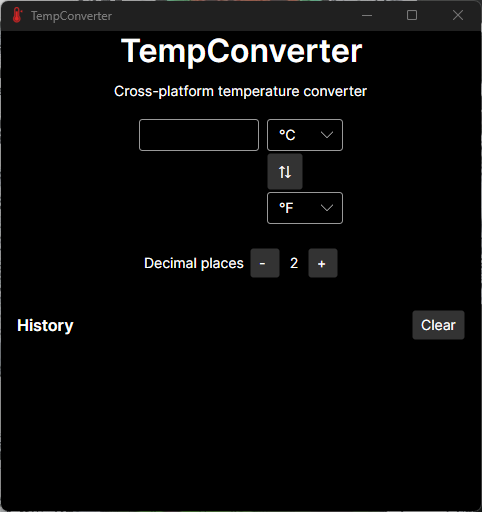
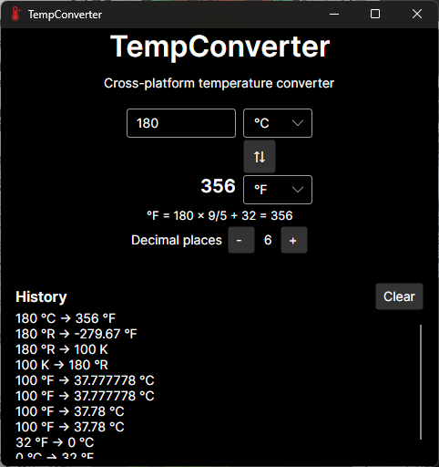

<h1 align="center">TempConverter</h1>

<div align="center">

[](https://github.com/hugoesparzac/TempConverter/actions/workflows/dotnet.yml)
[](https://github.com/hugoesparzac/TempConverter/releases/latest)
[](LICENSE)
[](CONTRIBUTING.md)


</div>

---

<p align="center">
  Cross-platform desktop temperature converter built with C#, .NET 10, and Avalonia UI using the MVVM pattern.
</p>

## Screenshots

| On launch | After a few conversions |
| --- | --- |
|  |  |

## Features

* Convert between Celsius, Fahrenheit, Kelvin, and Rankine in any direction
* Live result while typing, with the conversion formula shown
* Configurable number of decimal places (0 to 6)
* Swap source and target scales with a single gesture; the previous result becomes the new input
* Clear feedback for invalid input and values below absolute zero
* History of recent conversions, newest first, with a one-click clear

## Platform Status

| Platform | Build | Verified |
| --- | --- | --- |
| Linux x64 | `.deb`, `.rpm`, `.pkg.tar.zst`, `.tar.gz` | Yes — application manually exercised on Linux |
| Windows x64 | `.msi`, `.zip` | Partial — standalone `.exe` verified; `.msi` pending the first release |
| macOS arm64 / x64 | `.tar.gz` | Not yet |

## Downloads

Prebuilt binaries for the latest release are attached to the [releases page](https://github.com/hugoesparzac/TempConverter/releases/latest). The Windows `.msi` installs per user, under `%LOCALAPPDATA%\TempConverter`, and adds a Start Menu shortcut.

## Project Structure

```text
TempConverter/
├── src/
│   ├── TempConverter.App/          # Avalonia UI desktop application (Views & ViewModels)
│   └── TempConverter.Core/         # Core domain models and temperature conversion logic
└── tests/
    ├── TempConverter.App.Tests/    # Headless UI and ViewModel tests (Avalonia.Headless.XUnit)
    └── TempConverter.Core.Tests/   # Unit tests for core conversion logic (xUnit)
```

## Prerequisites

* [.NET 10 SDK](https://dotnet.microsoft.com/download/dotnet/10.0) (`10.0.404` or newer feature band)

## Getting Started

Restore dependencies, build the solution, and run the test suite:

```bash
dotnet restore
```

```bash
dotnet build --configuration Release
```

```bash
dotnet test --configuration Release
```

Run the desktop application:

```bash
dotnet run --project src/TempConverter.App
```

## Building Packages

`scripts/publish.sh` publishes self-contained binaries and, when [nfpm](https://github.com/goreleaser/nfpm) is on `PATH`, the native Linux packages:

```bash
./scripts/publish.sh 0.1.0
```

Override the target RIDs with the `RIDS` variable, for example `RIDS="linux-x64" ./scripts/publish.sh 0.1.0`. The Windows `.msi` requires the WiX Toolset 5, which only runs on Windows; tag a release and the CI workflow builds every package for you.

## Contributing

Please read [CONTRIBUTING.md](CONTRIBUTING.md) for branch naming rules, commit message conventions, and code style guidelines before submitting a pull request.

## License

This project is licensed under the MIT License — see the [LICENSE](LICENSE) file for details.
